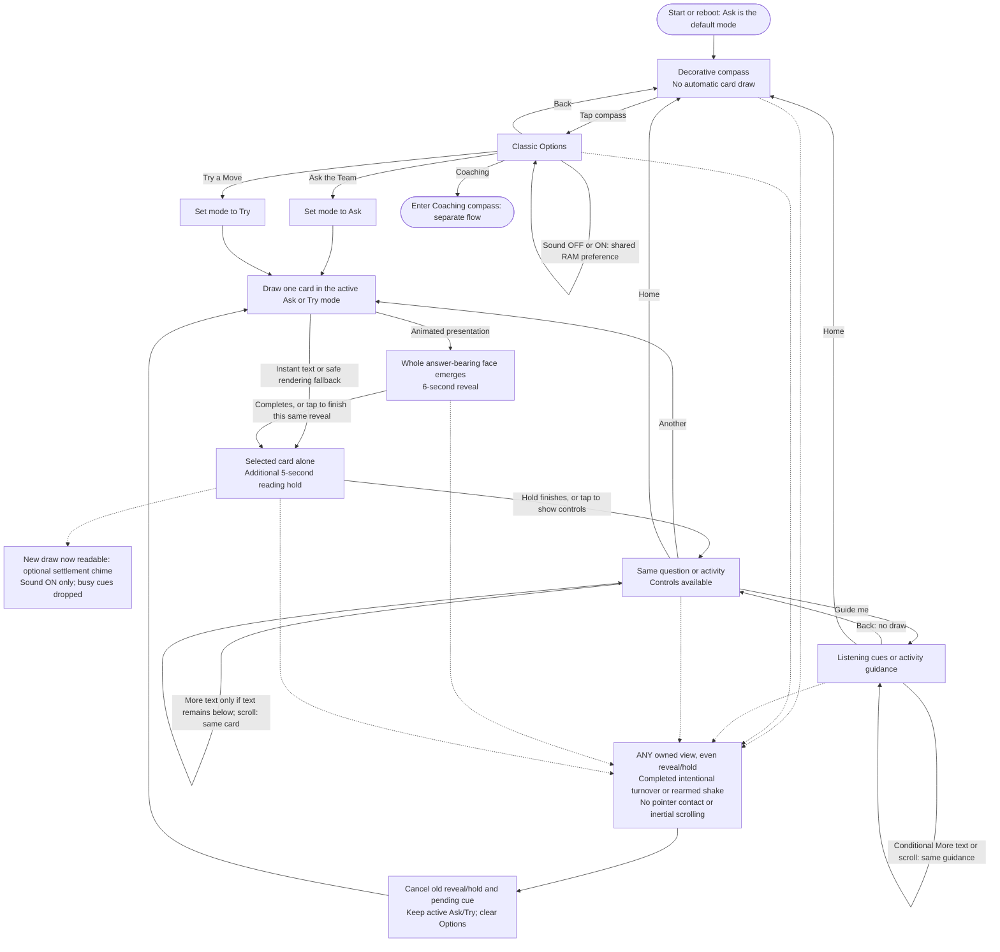

# Classic — prompt-deck flow

## Installed26 / published-source checkpoint

**The development device runs `v3-0.1.26-manual-s` DRAFT.** Full application readback and exact-version runtime checks passed; physical S-assisted shake acceptance is pending. Automatic shake reliability remains open.
See the [current progress and verification ledger](V3-PROGRESS.md) for the installed scope, prior physical failures and remaining checks.

The committed firmware baseline remains `v3-0.1.22-reliability`. This documentation checkpoint does not integrate or publish the later private source snapshots or firmware packages. Earlier release descriptions below retain their historical scope; they are not current26 physical acceptance.

**Classic offers one curated question or practical move at a time.** Use it for a quick spark, then return attention to the person or team.

This maps the installed V3 `v3-0.1.21-global-gestures` experience, not the broader planned Team Trail interface. Read alongside the [Coaching flow](COACHING-FLOW.md) and [project specification](PROJECT-SPEC.md).

**Approved direction: Coaching-first, with revised V3 wording as its content foundation.** This is not a startup-default change or a content merge: Classic still boots by default and remains an intact optional quick-prompt route. Coaching currently uses its own authored layer plus canonical references; neither all twelve Classic pairs nor the whole forty-card catalog has been merged into Coaching.

The candidate retains this navigation and six-second reveal plus five-second hold.
Runtime fault cancellation and pending-cue ownership are scoped in the ledger above;
no diagram restructuring or startup-default change is implied.

## What the choices mean

- **Ask the Team:** a spoken, open question from the Classic selection.
- **Try a Move:** a practical activity from that same selection of card identities.
- **Guide me:** support for the selected card, not a new draw. Ask guidance emphasizes listening; Try guidance emphasizes running the activity.
- **Another:** a fresh shuffled draw in the active mode. Each mode has its own bag; the twelve selected identities do not repeat within its cycle, and reshuffling avoids an immediate boundary repeat.
- **Home:** returns to the compass without drawing. A completed turnover or sustained shake from any owned view retains active Ask/Try, including a Try-on-Home return. Fresh boot defaults to Ask; explicit Ask/Try touch choices still change mode.

## Gesture, reading and navigation rules

- Touch mode selection and **Another** provide alternatives to motion. No essential prompt requires a gesture.
- A qualified inversion blacks the existing compass/card; a completed return selects exactly one new card. A canceled or invalid cycle restores the previous scene without drawing.
- Motion draws are eligible on Home/compass, Card, Guide and Options, including during reveal/hold; actual pointer contact and inertial scrolling suppress them.
- A completed intentional gesture cancels an old reveal or hold and starts one new card, never a queued draw; old callbacks/cues cannot affect the replacement. Autonomous settlement preserves partial intent and blackout.
- A tap can finish the same reveal and start its hold; a subsequent settled tap can expose controls. Neither consumes another draw.
- Guide/Back, scrolling and ordinary rerendering preserve the selected identity and do not replay the reveal. Full text remains accessible.
- Instant text bypasses the animation, not the card's identity or complete-copy access. A safe allocation/capture fallback is not a successful animation.

Classic no longer shows the constant ASK/DRAFT/flip footer; canonical review states remain draft. Classic **More text** and the Coaching scroll hint appear only when actual laid-out text remains below the visible viewport, including the opener’s 14px bottom clipping mask—not merely because padding permits scrolling. Mode centers, Options targets, six path controls, content, typography and reveal/hold timing are otherwise retained.

A completed intentional turn over and back or a deliberate sustained shake starts fresh from **any owned screen**, including Options, Guide, paths, questions, experiments, the path picker, closings, reminders, the Opening compass and an active reveal or reading hold. Classic draws once in its active Ask/Try mode, including after Home, and clears Options before showing the card. Coaching leaves the current path, clears route history and draws one fresh **Opening card**, not another question in that path or a return to the compass. Old reveal/hold resources and pending settlement cues are canceled: no old callbacks, queued draws or stale cues reach the replacement. Actual pointer contact and inertial scrolling still suppress motion. Partial gesture intent and qualified blackout survive autonomous same-card reveal settlement and hold deadlines. Turnover stays black while qualified inverted and starts the new reveal on completed return; shake goes straight to reveal without an extra timed black pause. Each new card retains the six-second whole-face reveal plus five-second reading hold. One sustained burst draws once; continuing to rattle cannot queue another card. Recognition retains 400ms of fresh quiet, 900ms of credited fresh motion and ten opposing peaks, then a 2200ms cooldown followed by fresh quiet to rearm. These are safeguards, not a prescribed handling ritual.

## Optional settlement sound

**Sound** is one shared, RAM-only preference in Classic Options and Coaching Options.
It defaults **OFF after every reboot**. Booting and toggling either way are silent.
When ON, an accepted new Classic card or explicitly requested new Coaching opener
can play one **240ms, 500Hz decaying settlement chime**, using a nominal PCM peak
of **1536**. It begins when that draw becomes readable: normally after the six-second
reveal, or immediately on same-card reveal completion, Instant text or safe fallback.
The additional five-second reading hold is unchanged. Initial Coaching entry is
silent even though it selects its first opener; context restoration, Guide/Back,
path browsing, scrolling and ordinary navigation never cue. Busy cues are dropped,
not queued. OFF requests cancellation of active playback; switching ON again does
not revive that canceled cue. Audio uses a low-priority TX-only worker; the ready
main loop services it once after UI/IMU work. No RX, DIN/MCLK, microphone, storage,
networking or OTA is enabled by this feature.

Button fills are `#0c1721` normal / `#1a2b38` pressed; apart from footer/conditional-cue cleanup, accepted fonts, icons, spacing and touch areas are retained. Physical Sound menu/mute/chime acceptance and narrower-face readability remain pending. The earlier single very soft bench tone is not acceptance of this cue.

The installed global start-fresh change is **qualitatively user-accepted in both Classic and Coaching**. This does not establish a trial count, exhaustive per-screen/per-gesture coverage or sustained field reliability. Earlier Coaching-compass shake and UI-cleanup acceptance remain historical evidence. Exhaustive readability/touch, Sound menu/mute/chime, uptime and battery acceptance remain separate. **The original intermittent turnover-stuck-compass/blank root cause remains OPEN**; global policy acceptance is not a diagnosis or proof of its repair. See [current evidence and acceptance limits](V3-TRIAL.md).

See the [global state/contact mapping](PROJECT-SPEC.md#global-gesture-state-and-contact-gates) for every owned view.

## Boundaries

Classic is offline, authored draft content—not live AI, a diagnosis or a record of use. Draws, reading and navigation do not record learning, team activity or outcomes. There is no implemented Team Trail, saved-card or history interface on V3.

Implementation references: [Classic UI](../trailguide_v3/ui.h), [deck model](../trailguide_v3/model.h), [turnover recognition](../trailguide_v3/gesture.h), sustained-shake detector `shake.h`, [whole-face renderer](../trailguide_v3/window_reveal.h), [current device evidence](V3-TRIAL.md).
