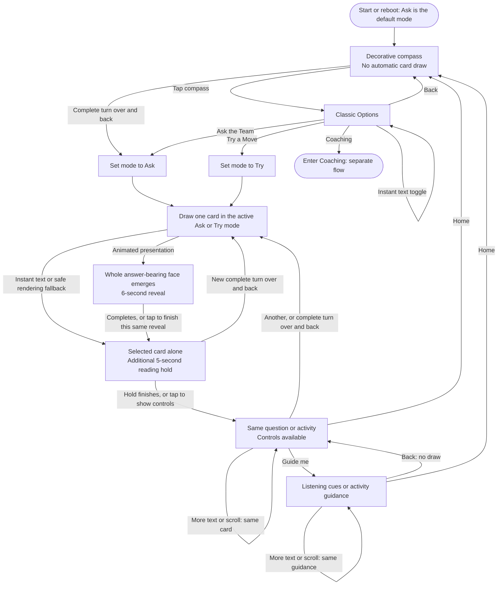

# Classic — prompt-deck flow

**Classic offers one curated question or practical move at a time.** Use it for a quick spark, then return attention to the person or team.

This maps the installed V3 `v3-0.1.14` experience, not the broader planned Team Trail interface. Read alongside the [Coaching flow](COACHING-FLOW.md) and [project specification](PROJECT-SPEC.md).

## What the choices mean

- **Ask the Team:** a spoken, open question from the Classic selection.
- **Try a Move:** a practical activity from that same selection of card identities.
- **Guide me:** support for the selected card, not a new draw. Ask guidance emphasizes listening; Try guidance emphasizes running the activity.
- **Another:** a fresh shuffled draw in the active mode. Each mode has its own bag; the twelve selected identities do not repeat within its cycle, and reshuffling avoids an immediate boundary repeat.
- **Home:** returns to the compass without drawing. A turnover from the compass explicitly draws Ask, even after a Try card; a turnover from a settled card retains that card's active mode. Choose Try a Move in Options when an activity is wanted.

## Gesture, reading and navigation rules

- Touch mode selection and **Another** provide alternatives to motion. No essential prompt requires a gesture.
- A qualified inversion blacks the existing compass/card; a completed return selects exactly one new card. A canceled or invalid cycle restores the previous scene without drawing.
- Motion draws are eligible on the compass or a settled main card, not in Options, Guide me, an active reveal, a held touch or scrolling.
- The five-second settled reading hold is separate from reveal-busy: a new eligible completed turn can draw during that hold.
- A tap can finish the same reveal and start its hold; a subsequent settled tap can expose controls. Neither consumes another draw.
- Guide/Back, scrolling and ordinary rerendering preserve the selected identity and do not replay the reveal. Full text remains accessible.
- Instant text bypasses the animation, not the card's identity or complete-copy access. A safe allocation/capture fallback is not a successful animation.

## Boundaries

Classic is offline, authored draft content—not live AI, a diagnosis or a record of use. Draws, reading and navigation do not record learning, team activity or outcomes. There is no implemented Team Trail, saved-card or history interface on V3.

Implementation references: [Classic UI](../trailguide_v3/ui.h), [deck model](../trailguide_v3/model.h), [gesture recognition](../trailguide_v3/gesture.h), [whole-face renderer](../trailguide_v3/window_reveal.h), [current device evidence](V3-TRIAL.md).
