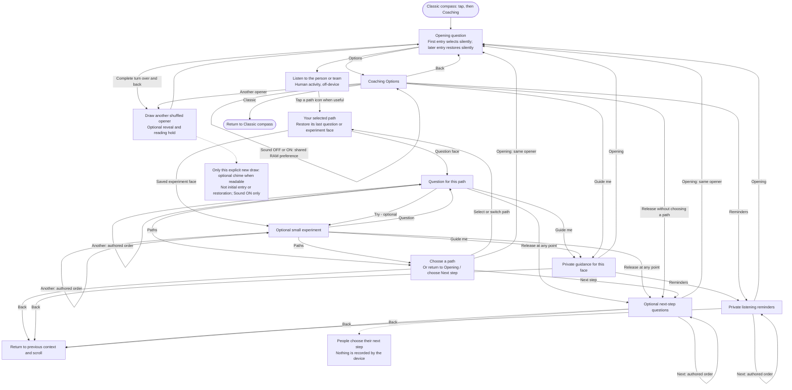

# Coaching — conversation-guide flow

**Coaching helps the facilitator open, listen, explore and release ownership of the next step.** The guide chooses the pace and direction; the device does not diagnose the team or listen to the conversation.

This maps the installed V3 `v3-0.1.16` experience. It is a flexible navigation map, not a required sequence. Read alongside the [Classic flow](CLASSIC-FLOW.md) and [project specification](PROJECT-SPEC.md).

## The six paths

These are selectable conversation contexts, **not diagnoses or permanent classifications**:

- **Progress — 12 o'clock:** explore what works, learning and possibilities to build on.
- **Stuck — 2 o'clock:** understand obstacles without immediately rescuing.
- **Unclear — 4 o'clock:** clarify goals, expectations and uncertainty.
- **Exploring — 6 o'clock:** examine alternatives and useful experiments. The small ring caption is **Explore**.
- **AI Results — 8 o'clock:** understand the gap between expected and actual AI output without assuming the prompt is the problem. The small ring caption is **AI**.
- **Team — 10 o'clock:** invite perspectives, participation and shared understanding.

Each path has four questions and three optional experiments. Questions and experiments cycle in authored order, with separate remembered positions. Choosing a path restores that path's last question/experiment face rather than always forcing its first question.

## Freedom to adapt

- The arrows show available routes, not automatic advancement. Skip, adapt, switch paths or finish when appropriate.
- **Release** has no question quota and requires no experiment. It is reachable from Options without choosing a path, from question/experiment screens, through **Next step** in the picker, and from private Guide/Reminders screens.
- **Guide me** and **Reminders** are for the facilitator, not questions to read to the team. Their **Back** route restores the actual prior context; the shared return box does not force a particular path.
- The three closing prompts support the people's own next step. The device does not capture, confirm, save or assess their response.
- **Opening** restores the exact prior opener and its scroll position without consuming a draw. Selecting **Classic**, then re-entering Coaching, also retains the opener within the current boot. Reboot clears this RAM-only context.

## Opening and presentation rules

- Six opening questions use their own shuffled pool. Only a deliberate new opener consumes that pool.
- Initial entry shows an opener directly; another opener from Options or a completed turnover uses the existing whole-face reveal, unless Instant text or a safe fallback bypasses it.
- Motion draws operate **only on the Opening screen**. Flipping while browsing a path, help, closing or Options cannot replace that content.
- Qualified inversion blacks the old opening scene; completed return starts the six-second reveal, followed by five additional seconds for reading. Cancellation restores the previous scene. Tap alternatives and early reveal/hold completion remain available.
- The coaching blue face is 192x112 inside the unchanged 256x140 capture panel, with 18px body text, 168px opening wrap and 12px ring/Options captions. Invisible touch targets remain generous; long text is scrollable.

## Optional settlement sound

**Sound** is one shared, RAM-only preference in Classic Options and Coaching Options.
It defaults **OFF after every reboot**. Booting and toggling either way are silent.
When ON, an accepted new Classic card or explicitly requested new Coaching opener
can play one **240ms, 500Hz decaying settlement chime**, using a nominal PCM peak
of **1536**. It begins when that draw becomes readable: normally after the six-second
reveal, or immediately on same-card reveal completion, Instant text or safe fallback.
The additional five-second reading hold is unchanged. Initial Coaching entry is
silent even though it selects its first opener; context restoration, Guide/Back,
path browsing, scrolling and ordinary navigation never cue. Busy cues are dropped,
not queued. OFF requests cancellation of active playback; switching ON again does
not revive that canceled cue. Audio uses a low-priority TX-only worker; the ready
main loop services it once after UI/IMU work. No RX, DIN/MCLK, microphone, storage,
networking or OTA is enabled by this feature.

Button fills are `#0c1721` normal / `#1a2b38` pressed; main-card pixels, icons, fonts, spacing and existing touch areas are unchanged. Physical Sound menu/mute/chime acceptance and narrower-face readability remain pending. The earlier single very soft bench tone is not acceptance of this cue.

## Boundaries

Coaching is offline, authored draft guidance. There is no microphone, live AI, automatic team assessment, mandatory sequence, participant tracking or persistent conversation history. The learner-facing loop remains **Define → Direct → Check → Adjust**; these paths are optional private facilitator aids, not a replacement curriculum.

Implementation references: [coaching UI](../trailguide_v3/coaching_ui.h), [context/navigation model](../trailguide_v3/coaching_model.h), [authored coaching content](../content/coaching.json), [browser/native distinction](COMPASS-COACHING-PREVIEW.md), [current device evidence](V3-TRIAL.md).
