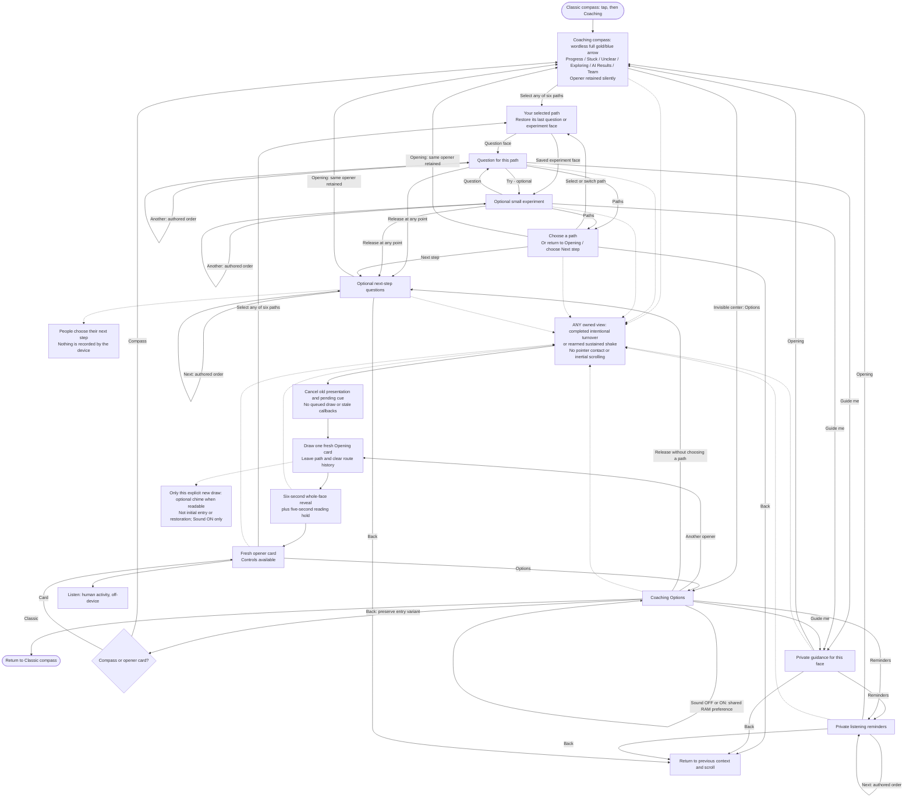

# Coaching — conversation-guide flow

**Coaching helps the facilitator open, listen, explore and release ownership of the next step.** The guide chooses the pace and direction; the device does not diagnose the team or listen to the conversation.

This maps the installed V3 `v3-0.1.21-global-gestures` experience. It is a flexible navigation map, not a required sequence. Read alongside the [Classic flow](CLASSIC-FLOW.md) and [project specification](PROJECT-SPEC.md).

**Approved direction: Coaching-first, with revised V3 wording as its content foundation.** This is not a startup-default change or a content merge: Classic still boots by default and remains an intact optional quick-prompt route. Coaching currently uses its own authored layer plus canonical references; neither all twelve Classic pairs nor the whole forty-card catalog has been merged into Coaching.

## The six paths

These are selectable conversation contexts, **not diagnoses or permanent classifications**:

- **Progress — 12 o'clock:** explore what works, learning and possibilities to build on.
- **Stuck — 2 o'clock:** understand obstacles without immediately rescuing.
- **Unclear — 4 o'clock:** clarify goals, expectations and uncertainty.
- **Exploring — 6 o'clock:** examine alternatives and useful experiments. The small ring caption is **Explore**.
- **AI Results — 8 o'clock:** understand the gap between expected and actual AI output without assuming the prompt is the problem. The small ring caption is **AI**.
- **Team — 10 o'clock:** invite perspectives, participation and shared understanding.

Each path has four questions and three optional experiments. Questions and experiments cycle in authored order, with separate remembered positions. Choosing a path restores that path's last question/experiment face rather than always forcing its first question.

## Freedom to adapt

- The arrows show available routes, not automatic advancement. Skip, adapt, switch paths or finish when appropriate.
- **Release** has no question quota and requires no experiment. It is reachable from Options without choosing a path, from question/experiment screens, through **Next step** in the picker, and from private Guide/Reminders screens.
- **Guide me** and **Reminders** are for the facilitator, not questions to read to the team. Their **Back** route restores the actual prior context; the shared return box does not force a particular path.
- The three closing prompts support the people's own next step. The device does not capture, confirm, save or assess their response.
- **Opening** returns to the compass, preserving the exact prior opener and its saved scroll context without consuming a draw. Selecting **Classic**, then re-entering Coaching, also retains the opener within the current boot. Reboot clears this RAM-only context.

## Opening and presentation rules

- Six opening questions use their own shuffled pool. Initial entry selects silently; after that, only a deliberate new opener consumes that pool.
- Entry shows the compass, not an opener question: the model selects/retains the opener silently. Another opener from Options, or a completed intentional turnover/shake from any owned screen, switches to a fresh blue Opening-card reveal, unless Instant text or a safe fallback bypasses it.
- The compass has six labelled path icons and an invisible **136x64 center Options** target. Its independent decorative LCG wandering never selects a path, changes the opener or consumes a draw. Options Back restores whichever Opening variant opened it.
- Motion draws operate on **every owned screen**: Opening/compass, Question, Experiment, Guide, Reminders, Closing, Picker and Options, including reveal/hold. They leave the path, clear route history and draw a fresh Opening card, not another question in that path. Actual pointer contact and inertial scrolling still suppress them.
- Qualified inversion blacks the old owned scene; completed return starts the six-second reveal, followed by five additional seconds for reading. Cancellation restores the previous scene. Tap alternatives and early reveal/hold completion remain available.
- The explicit opener-card variant (not compass entry) retains a blue face of 192x112 inside the unchanged 256x140 capture panel, with 18px body text, 168px opening wrap and 12px ring/Options captions. Invisible touch targets remain generous; long text is scrollable.

Classic no longer shows the constant ASK/DRAFT/flip footer; canonical review states remain draft. Classic **More text** and the Coaching scroll hint appear only when actual laid-out text remains below the visible viewport, including the opener’s 14px bottom clipping mask—not merely because padding permits scrolling. Mode centers, Options targets, six path controls, content, typography and reveal/hold timing are otherwise retained.

A completed intentional turn over and back or a deliberate sustained shake starts fresh from **any owned screen**, including Options, Guide, paths, questions, experiments, the path picker, closings, reminders, the Opening compass and an active reveal or reading hold. Classic draws once in its active Ask/Try mode, including after Home, and clears Options before showing the card. Coaching leaves the current path, clears route history and draws one fresh **Opening card**, not another question in that path or a return to the compass. Old reveal/hold resources and pending settlement cues are canceled: no old callbacks, queued draws or stale cues reach the replacement. Actual pointer contact and inertial scrolling still suppress motion. Partial gesture intent and qualified blackout survive autonomous same-card reveal settlement and hold deadlines. Turnover stays black while qualified inverted and starts the new reveal on completed return; shake goes straight to reveal without an extra timed black pause. Each new card retains the six-second whole-face reveal plus five-second reading hold. One sustained burst draws once; continuing to rattle cannot queue another card. Recognition retains 400ms of fresh quiet, 900ms of credited fresh motion and ten opposing peaks, then a 2200ms cooldown followed by fresh quiet to rearm. These are safeguards, not a prescribed handling ritual.

## Optional settlement sound

**Sound** is one shared, RAM-only preference in Classic Options and Coaching Options.
It defaults **OFF after every reboot**. Booting and toggling either way are silent.
When ON, an accepted new Classic card or explicitly requested new Coaching opener
can play one **240ms, 500Hz decaying settlement chime**, using a nominal PCM peak
of **1536**. It begins when that draw becomes readable: normally after the six-second
reveal, or immediately on same-card reveal completion, Instant text or safe fallback.
The additional five-second reading hold is unchanged. Initial Coaching entry is
silent even though it selects its first opener; context restoration, Guide/Back,
path browsing, scrolling and ordinary navigation never cue. Busy cues are dropped,
not queued. OFF requests cancellation of active playback; switching ON again does
not revive that canceled cue. Audio uses a low-priority TX-only worker; the ready
main loop services it once after UI/IMU work. No RX, DIN/MCLK, microphone, storage,
networking or OTA is enabled by this feature.

Button fills are `#0c1721` normal / `#1a2b38` pressed; apart from conditional text cues, accepted fonts, icons, spacing and touch areas are retained. The quieter button appearance is physically approved and preserved. Physical Sound menu/mute/chime acceptance and narrower-face readability remain pending. The earlier single very soft bench tone is not acceptance of this cue.

The installed global start-fresh change is **qualitatively user-accepted in both Classic and Coaching**. This does not establish a trial count, exhaustive per-screen/per-gesture coverage or sustained field reliability. Earlier Coaching-compass shake and UI-cleanup acceptance remain historical evidence. Exhaustive readability/touch, Sound menu/mute/chime, uptime and battery acceptance remain separate. **The original intermittent turnover-stuck-compass/blank root cause remains OPEN**; global policy acceptance is not a diagnosis or proof of its repair.

See the [global state/contact mapping](PROJECT-SPEC.md#global-gesture-state-and-contact-gates) for every owned view.

## Boundaries

Coaching is offline, authored draft guidance. There is no microphone, live AI, automatic team assessment, mandatory sequence, participant tracking or persistent conversation history. The learner-facing loop remains **Define → Direct → Check → Adjust**; these paths are optional private facilitator aids, not a replacement curriculum.

Implementation references: [coaching UI](../trailguide_v3/coaching_ui.h), [context/navigation model](../trailguide_v3/coaching_model.h), [authored coaching content](../content/coaching.json), [browser/native distinction](COMPASS-COACHING-PREVIEW.md), [current device evidence](V3-TRIAL.md).
