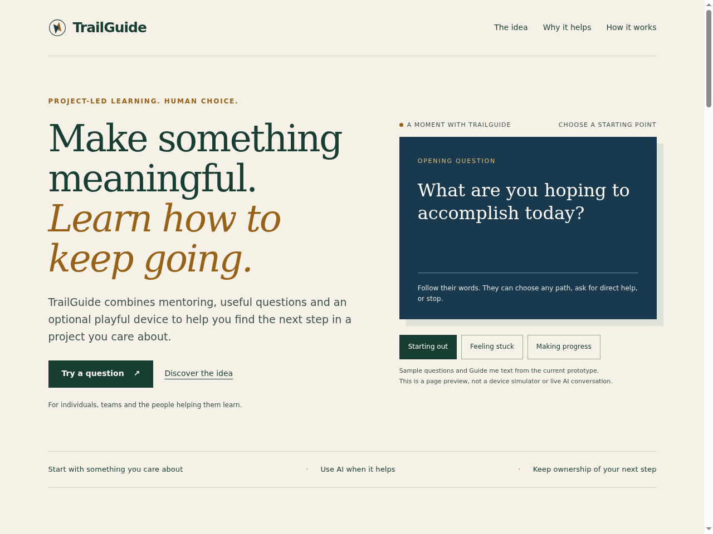

# TrailGuide

[Printable marketing PDF](TrailGuide-marketing.pdf) · [Designed HTML page](index.html)

The HTML file contains the interactive design. On GitHub, download it and open it in a browser; this publication does not enable GitHub Pages hosting.

*Project-led learning. Human choice.*

## Make something meaningful. Learn how to keep going.

TrailGuide combines mentoring, useful questions and an optional playful device to help you find the next step in a project you care about.

For individuals, teams and the people helping them learn.

Opening question

> What are you hoping to accomplish today?

Follow their words. They can choose any path, ask for direct help, or stop.

Sample questions and Guide me text from the current prototype. This is a page preview, not a device simulator or live AI conversation.

*What it is*

## A little guidance for the work you want to do.

You have an idea, a half-finished project or a team trying to move forward. Sometimes the useful thing is a better question. Sometimes it is a small experiment. Sometimes you need someone to show you how.

TrailGuide brings those choices into a project conversation. Use its mentoring materials on their own, or let the handheld companion offer a question, an optional activity or guidance for the person helping.

Build a tool. Explore a question. Write something worth sharing. The project gives learning a purpose, and you decide what kind of help belongs in it.

## The aim is a next step you understand and choose for yourself.

A mentor can help. AI can explain, explore, build or check. TrailGuide keeps the learner's project and decisions at the centre.

*Why you would use it*

## Useful help. Room to think for yourself.

TrailGuide is designed around the moments when a project needs direction, a fresh approach or a pause to notice what worked.

### Make the next step manageable

Turn a broad ambition into one useful piece you can try. You do not need the whole project mapped out to begin.

### Get help that fits the moment

Choose a question, an explanation, a worked example or direct help. Adapt or skip a suggestion when another approach suits you better.

### Give mentoring a starting point

Use a shared prompt to open a conversation. Guide me offers the mentor listening cues and follow-up support without turning the exchange into a script.

### Use AI with a purpose

Decide what help you need, give it context and check what matters. Judge the whole effort, including corrections and what you learned, rather than how fast an answer appeared.

### Leave with a way to continue

The reusable project brief gives you a place to keep your goal, useful context and preferred help style for the next conversation, with a person or an AI you choose.

These are the intended benefits of the design. TrailGuide is still a prototype; improved learning, independence and team outcomes have not been established.

*A pattern you can reuse*

## Define → Direct → Check → Adjust

Use the same four steps for a new project, a difficult question or the next small improvement. Work with a mentor, with AI or without either.

### 01 Define

Choose what you want to make, investigate or improve. Decide what a useful result would look like and how you will check it.

### 02 Direct

Choose the help you want and give it the context it needs. You might ask for an explanation, a collaborator or a working example.

### 03 Check

Try the result. Compare what happened with what you wanted. Look for evidence that matters for this task.

### 04 Adjust

Change the work, the instructions or the approach. Keep enough context to take the next step.

For example: choose one interaction in a tool you want to build, ask for the kind of help you need, try it, then decide what to change. The finished tool does not need an AI feature.

*The optional companion*

## A little curiosity in your hand.

The round-screen TrailGuide prototype brings a question into the room. Pick a conversation path, explore an optional activity or draw a fresh idea.

It gives people something to gather around without making the device the centre of the learning. The curated prompts work offline; live AI is not built into the device.

The playful draw adds an element of discovery. Touch controls let you explore the questions at your own pace. You can also use the mentoring materials without hardware.

### Picture a real conversation

#### An idea feels too big.

A learner wants to make something but cannot see where to start. Use the conversation to choose a useful first piece and the help they want.

#### A project has hit a snag.

Start with what the person tried and what happened. Explore one small test or give the direct help they ask for.

#### Something is working.

Notice what helped and what to build on. A mentoring conversation does not need to begin with a problem.

*Who it is for*

## People with projects. People helping people.

For a person exploring a new skill, a mentor supporting a learner, or a team making something together. The starting point is a real project, not a requirement to master a particular AI tool.

People can speak, write, observe, ask for help or pass. Using more AI is not the measure of success. A human-only approach remains a valid choice.

*Bring your project*

## Start with something you want to make happen.

Explore the questions, use the mentoring materials and see how TrailGuide could fit the way you learn or help others.

## Where things stand

Working prototype. Product vision in development.

The project includes reusable draft mentoring materials and a working V3 device prototype. It is not a validated curriculum, an integrated AI coaching service or a production-ready retail product. This page does not offer a purchase, price or release date.

Some automatic motion interactions remain unresolved. Touch is the current alternative for exploring Coaching. The page examples do not establish physical-device reliability or educational effectiveness.

[Explore the project](https://github.com/luminerdy/TrailGuide) · [Mentoring direction](../COACHING-DIRECTION.md) · [Current questions](../COACHING-DISPLAY-GUIDE.md) · [Prototype status](../RELEASE-v3-0.1.31.md)
