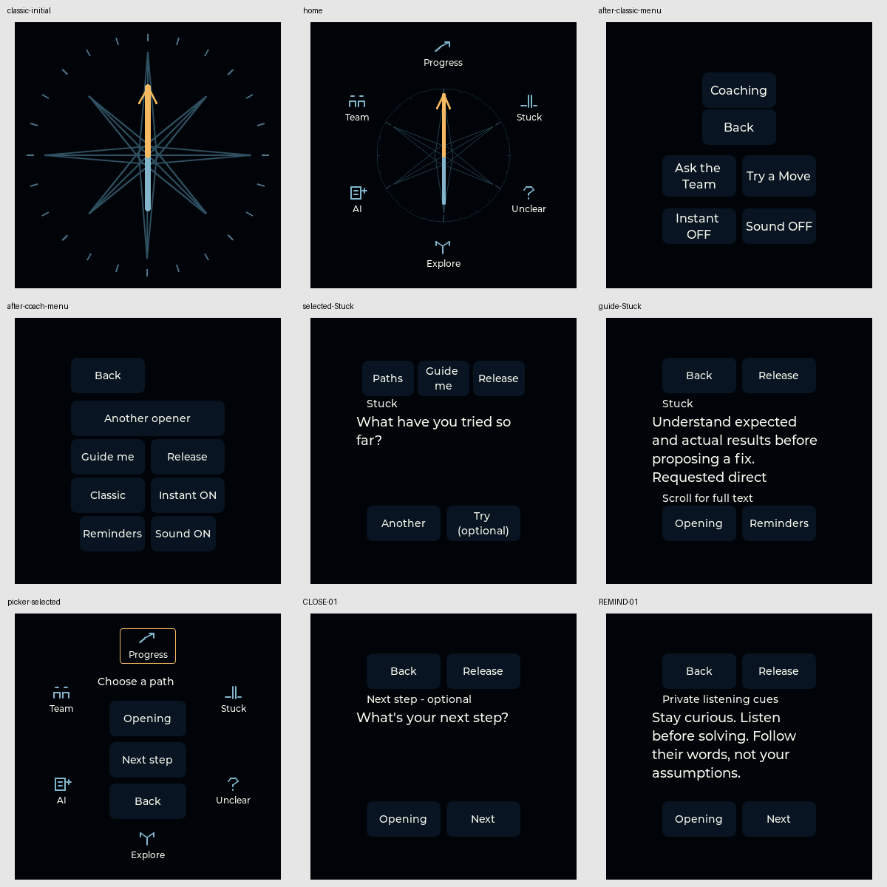
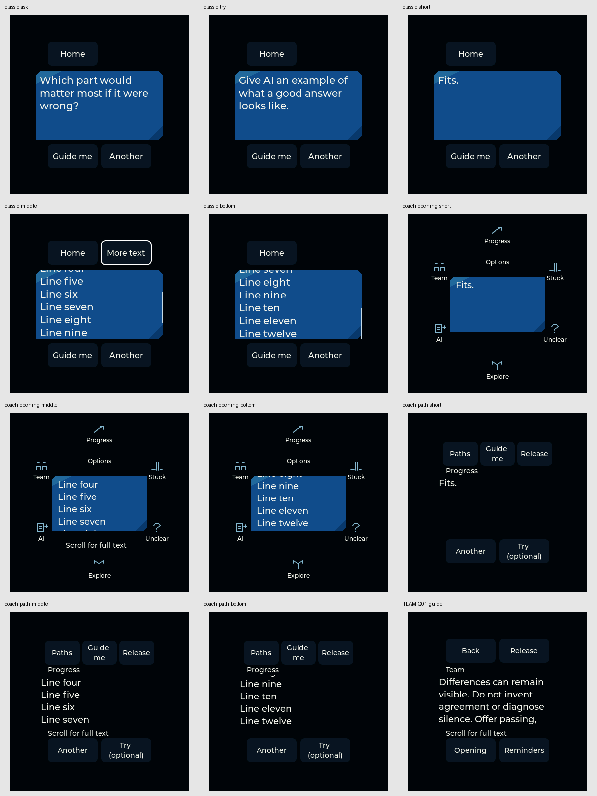
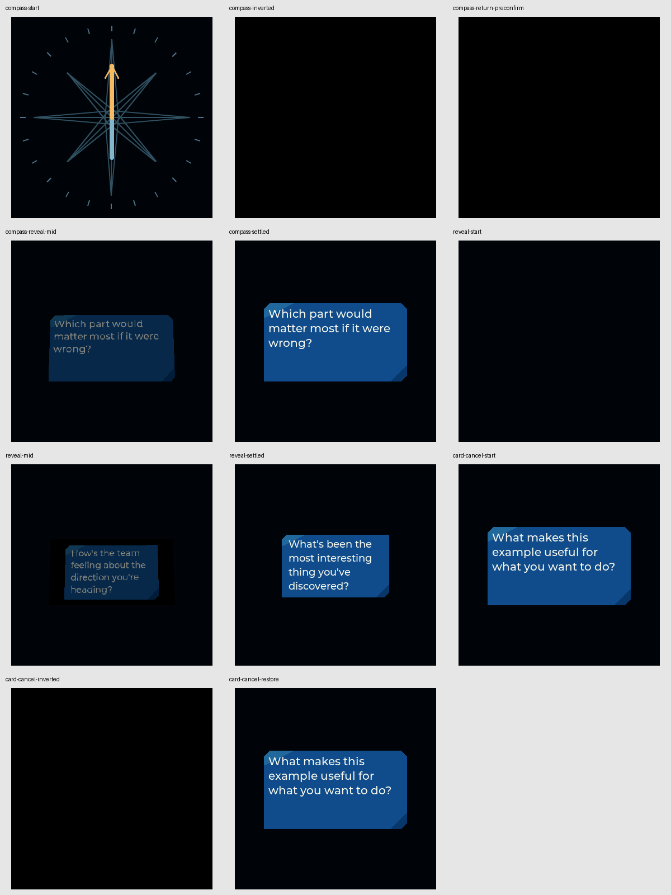

# UI review — TrailGuide v3-0.1.21

## Executive assessment

**Keep the accepted visual design. Improve consistency and learnability before redesigning it.** The selected actual-native evidence shows a coherent visual identity, a dominant prompt, subordinate controls, complete-copy scrolling and truthful conditional continuation cues. No confirmed rendering defect was identified in the selected captures.

The most useful improvements to discuss are:

1. Decide whether **Instant** should be a shared RAM-only preference rather than the current one-way inheritance between modes.
2. Consider preserving **Classic reading position** when consulting Guide and returning to the same card.
3. Provide a short **optional operating reference** that distinguishes a fresh start from browsing/restoring context, without adding clutter to the approved compass.
4. Validate whether important qualifications in long guidance are found, then consider an approved editorial ordering pass only if needed.
5. Check the actual panel in intended grip, brightness and lighting before changing fonts, target sizes or quiet control fills.

These are recommendations, not implemented changes. Confirmed source behaviors are distinguished from possible usability difficulties: the user has not reported these as failures. The successful global restart remains intact.

## Evidence and boundaries

- Reviewed the installed/accepted v3-0.1.21 source and the actual UI/model callers, rather than treating a historical browser study as the device.
- Inspected **32 selected 360×360 native LVGL captures**, drawn from an archive whose **533 frame hashes** were verified. Selection covers both entries/menus, canonical questions/guidance, optional closing/reminders, overflow states, reveal and cancellation.
- Software framebuffers are **not panel photographs**. Stills do not establish physical contrast, smoothness, FPS, gesture comfort, touch accuracy or field reliability.
- Several overflow images intentionally use synthetic “Fits”/“Line” copy. They demonstrate layout boundaries, not proposed new content. A partially visible preceding line at a scrolled viewport edge is not itself a clipping bug.
- The current user approval is qualitative acceptance of both modes and anticipated field fit—not a quantified, exhaustive or sustained field trial.
- Source and artifact checks were read-only. No new browser, native suite, hardware, motion recording, reset, install, layout or content change was performed for this UI review.

## Preserve explicitly

- The full unobstructed gold/blue arrow, six labelled paths and wordless center Options target on Coaching home.
- The accepted compact blue face, typography, palette, quiet buttons and generous invisible hit targets.
- Six-second whole-face reveal plus five-second reading hold, with existing same-card touch escape and optional Instant.
- Global intentional flip/shake: Classic keeps Ask/Try; Coaching draws a fresh opener and leaves the route. Touch/inertial-scroll protection and one-event rearming remain.
- Conditional More/scroll cues only when meaningful text remains below; complete authored copy stays reachable.
- Classic availability and its boot default. Coaching-first direction does not silently change startup behavior.
- Optional private guidance, passing, direct assistance and unrestricted release. No quotas, mandatory experiments, inferred learner diagnoses or success-looking outcome records.
- Shared default-OFF RAM-only Sound, with no new microphone/networking/persistence feature.

## Confirmed source observations versus hypotheses

### Confirmed, but not established requirement violations

- **Instant is asymmetric.** Classic copies its boolean into Coaching on each entry. Coaching can change its own boolean, but exit does not copy it back. Re-entering Coaching can therefore overwrite that local choice. Sound, in contrast, already uses a shared object. A shared-Instant requirement has not been previously established.
- **Classic Guide/Back preserves identity, not scroll offset.** It rebuilds scroll objects and returns to the top. Coaching already remembers per-face scroll. Whether Classic should behave similarly is a usability decision.
- **Long guidance spans multiple viewports.** The initial Stuck guide ends at “Requested direct”; the Team example ends at “Offer passing,”. The remaining permissions and alternatives are reachable by scrolling with a continuation cue. This is a reading-flow limitation, not missing copy.
- **Button boundaries are deliberately quiet.** Labels are more prominent than the subtle fill/background separation. No demonstrated inability to locate them follows from that appearance.

### Hypotheses that require observation

A new facilitator might miss invisible Options, confuse Opening with Another opener, overlook a below-fold qualification, or find some targets difficult with a particular grip. No such physical failure was observed in this review. Test those hypotheses before changing an approved design.

## Actual navigation and selection contract

The following distinguishes a new choice from restoring context. None of these actions records use, consent, progress or learning outcomes.

- **Boot → Classic compass:** no automatic Classic draw; initial mode is Ask.
- **Classic compass tap → Options:** the implemented active compass area is wider than only its hub, bounded by the safe-circle hit policy.
- **Ask the Team / Try a Move:** a new shuffled card in the chosen mode, not just a mode setting. Separate Ask/Try bags are retained.
- **Classic Another / global flip-shake:** a new card in active Ask/Try. The explicit global shortcut also works during reveal/hold.
- **Classic Guide → Back:** same card/mode, currently top-of-text rather than saved scroll.
- **Classic Home / Options Back:** compass, with mode retained; there is no dedicated resume-card control. Explicit Ask/Try draws anew.
- **Classic Options → Coaching:** compass entry, with retained opener/per-path RAM state. Initial entry can select an opener in the model without displaying/revealing it or earning a cue. Classic Instant is copied into Coaching.
- **Coaching compass center → Options → Back:** restores the compass versus opening-card entry variant, without consuming an opener.
- **Choose a path:** restores that path’s remembered question/experiment face, index and scroll; first use begins at its first question. The decorative needle does not choose a path.
- **Path Another:** advances in authored order within the current face type; it is not a new random opener.
- **Try (optional) ↔ Question:** peer views with separate remembered positions, not a required next step or automatic draw.
- **Paths / Guide / Reminders / Back:** restore their corresponding saved route/face context. Back can return through nested help or Options; it does not always mean the main question.
- **Release / Next step:** optional closing support, available without a question quota or experiment. Back restores context; no completion/save is recorded.
- **Next in Closing/Reminders:** next authored item of that type, not a general conversation engine.
- **Opening:** returns to the Coaching compass, retaining the old opener in RAM; it does not draw a fresh opener or display that hidden old opener.
- **Another opener / global flip-shake in Coaching:** new blue Opening card; route history is cleared and opener scroll resets. Per-path face memories remain. “Start fresh” is not a factory reset of every memory or shuffle bag.
- **Coaching → Classic:** Classic compass, active Classic mode retained; Sound carries across, Coaching Instant does not copy back.
- **Partial/canceled inversion:** restores the old scene with no draw. The blackout-canceling touch is consumed so it cannot accidentally activate a newly exposed control.
- **Tap during reveal / next settled tap:** finish the same reveal and start its hold, then expose controls. Instant skips the reveal, not the reading hold or decorative compass motion.

## Eight improvement candidates

Priorities below are a suggested discussion order, not defect severity or permission to implement. Each candidate has a small observable check, rather than requiring exhaustive manual inspection.

### UI-01 — Make optional operation guidance easy to find

**Evidence:** UX-01/07 and UV-04/08. Wordless home and invisible center Options are deliberate. The existing flow documents explain operation, but there is no separate device-controls tutorial in the inspected action inventory. First-use confusion has not been measured.

**Proposal:** condense existing documentation into an optional off-device quick reference covering touch-only entry, center Options, paths, the reveal/hold tap escape, Instant, global start-fresh, and least-destructive recovery. Keep this separate from Guide me, which is private card/facilitation guidance. An optional Options help preview is a later possibility only if needed—not mandatory onboarding or persistent chrome.

**Benefit/cost:** high potential learnability value; low editorial effort. Adding on-device help would be a separate medium-cost design decision.

**Risk:** overexplaining or cluttering a liked interface. Do not add a center caption, confirmation gate or recovery overlay by default.

**Check:** with and without the optional reference, ask an unfamiliar facilitator to reach Coaching, obtain a prompt and locate Instant using touch. Observe hesitations without scoring ability. For recovery, distinguish an intentional black/reveal/hold state from an unresponsive device; normal touch may help, but do not promise a universal cure or trigger automatic resets/recording.

**Source:** `trailguide_v3/ui.h:56-104,111-120,172-179`; `trailguide_v3/coaching_ui.h:61-103,144-153,190-199`.

### UI-02 — Clarify the scope of navigation words

**Evidence:** UX-02 and UV-03. Back, Opening, Another, Another opener, Paths, Release, Next step and Next have different scopes. Short controls are useful; an ambiguous prediction is not yet an observed failure.

**Proposal:** use the navigation contract above in optional orientation. Explain return-to-compass versus new-opener, authored browsing versus shuffle, private guidance and optional release without recording. Only preview device wording after actual confusion is observed.

**Benefit/cost:** fewer unintended resets and mistaken expectations; low editorial effort, medium if device copy changes.

**Risk:** longer labels wrap or disrupt familiar routes; canonical prompt text must not be casually rewritten.

**Check:** before activation, ask what Opening, Another opener, Release and Back will do and whether they create a new prompt or record. Compare predictions with actual routes.

**Source:** `trailguide_v3/coaching_model.h:29-43`; `trailguide_v3/coaching_ui.h:75-103`; `trailguide_v3/ui.h:89-104`.

### UI-03 — Decide who owns Instant across modes

**Evidence:** UX-03. One-way copying is confirmed in source; no observed user failure or previously agreed shared-Instant contract is asserted.

**Proposal:** discuss either one shared RAM-only preference, matching Sound, or explicitly documented mode-local behavior without surprising overwrite. Current ON/OFF labels should be understood as state, not a promise of persistence. Do not conflate Instant with changing hold time or compass motion.

**Benefit/cost:** predictable optional animation preference; low-to-medium effort.

**Risk:** silently changing preference semantics or the approved timing. Requires approval and a round-trip regression.

**Check:** toggle in Coaching, leave via Classic, re-enter, and compare expected, displayed and applied state. If shared behavior is approved, test both directions plus fresh-boot defaults with actual native pointer input.

**Source:** `trailguide_v3/ui.h:17-18,90,100-104,164,169`; `trailguide_v3/coaching_ui.h:24,71-73,102,174,179`.

### UI-04 — Preserve Classic reading position when consulting Guide

**Evidence:** UX-04. Classic retains card identity but rebuilds reading position; Coaching already has per-face memories.

**Proposal:** consider independent main/guide offsets for the same identity and face, reset by a genuine new draw. Do not add persistent history, new Home resume semantics or restart undo as part of this small change.

**Benefit/cost:** less repositioning while consulting help; medium effort.

**Risk:** stale offsets applied to another card, mode or shorter body.

**Check:** scroll a long Classic card, consult Guide, return and assess whether resuming helps. An approved implementation must preserve identity/RNG, distinguish Ask/Try offsets and reset new draws to top.

**Source:** `trailguide_v3/model.h:17-31`; `trailguide_v3/ui.h:73-101`; compare `trailguide_v3/coaching_model.h:23-43` and `coaching_ui.h:87,98`.

### UI-05 — Check that long guidance exposes its important qualifications

**Evidence:** UV-01. Canonical examples span viewports; the observed direct-help and passing/alternatives qualifications continue below the initial viewport. Full copy exists and the cue is present.

**Proposal:** first validate complete-copy retrieval with the existing design. If readers miss the qualifications, offer an editorial first-viewport ordering pass preserving every permission, condition and meaning. Do not shrink type, silently summarize, drop clauses or enlarge the viewport by default.

**Benefit/cost:** safeguards remain discoverable; small evaluation, medium editorial candidate if approved.

**Risk:** changing meaning, turning optional help into a requirement, or trading readable type for fit.

**Check:** on Stuck and Team, find the final guidance, explain that direct help/passing/alternatives are allowed, and return without losing path context. Compare any candidate at the same settings.

**Source:** `trailguide_v3/coaching_ui.h:80-94,160-168`; `content/coaching.json:123,263`.

### UI-06 — Protect full-copy access without extra permanent chrome

**Evidence:** UX-06 and UV-05. Short and final-line fixtures omit continuation hints; middle states show More text or Scroll for full text. Expected cropped preceding lines are not missing content.

**Proposal:** retain current conditional behavior and document existing Classic paging versus touch scrolling. Add canonical top/middle/bottom examples to the review checklist alongside synthetic stress cases. Consider extra paging/progress controls only if a demonstrated access problem warrants them.

**Benefit/cost:** protects complete copy and uncluttered reading; low evaluation, medium for any new control.

**Risk:** a false hint suggests missing copy; extra controls compete with fixed actions.

**Check:** reach the last and first canonical lines with touch; confirm the cue returns when text remains below and disappears at the end. Retain mask/blank/focus-restoration regressions.

**Source:** `trailguide_v3/ui.h:99,153-159`; `trailguide_v3/coaching_ui.h:160-168,182-188`; `tests/v3_ui_cleanup_native_test.cpp:24-57`.

### UI-07 — Validate real reading and grip before changing geometry

**Evidence:** UX-05 and UV-06/07. Captures support a contained circular composition and prominent text, not physical usability certification. Existing targets include 48-pixel-high controls, side path targets, and a 136×64 center Options region. Pixels are not measured millimeters.

**Proposal:** keep approved fonts/colors/geometry while checking actual brightness, viewing distance, ordinary ambient light and intended grip. Assess center/edge/gap touches and left/right reach without assuming symmetry proves ease. Do not deliberately wet the device or prescribe glove tests without establishing permitted hardware conditions.

**Benefit/cost:** evidence-driven access improvements; low bounded observation, medium systematic input-boundary testing.

**Risk:** enlarged/moved targets overlap content or interfere with safe-circle hit regions. Do not introduce a handedness mode or claim accessibility compliance by default.

**Check:** choose side paths, read full guidance, use Guide and Release with intended grip; distinguish text-size, glare, semantic and touch errors. Extend native boundary/drag-out checks separately. Compare any requested candidate under identical settings.

**Source:** `trailguide_v3/ui.h:56-86,128,184`; `trailguide_v3/coaching_ui.h:61-92,214-215`; retained native path/pointer tests.

### UI-08 — Keep quiet controls unless location/state proves hard to perceive

**Evidence:** UV-02. Labels carry more affordance than subtle button silhouettes. Selected/focused outlines are stronger. This is an approved visual tradeoff, not a demonstrated failure.

**Proposal:** retain quiet fills. Only if action-location or pressed/focus recognition causes actual difficulty, preview a small state-feedback refinement rather than brightening every boundary.

**Benefit/cost:** possible glanceability improvement; low evaluation and a small candidate if requested.

**Risk:** adding noise and undoing a specifically liked treatment.

**Check:** at real settings, locate Back, Guide me and Another and distinguish current selection/press/focus without explanation; compare error patterns before requesting a visual change.

**Source:** `trailguide_v3/coaching_ui.h:63-73,214`; `trailguide_v3/ui.h:184`.

## Actual-native evidence examples

These contact sheets are derived from native framebuffer captures, not design mockups or physical photographs. Small montage text is not a valid real-size readability test. The source archive retains full-size frames and their hashes.

### Entry and navigation

### Reading and overflow

### Reveal and restoration

## Suggested small next increment — discussion only

1. Address the code review’s failing gate and robustness findings before bundling cosmetic changes.
2. Agree the intended Instant ownership and whether Classic scroll restoration is useful.
3. Draft the optional operating reference from the existing flow contract.
4. Conduct a small, explicitly agreed usability check around first use and full guidance retrieval.
5. Preview only improvements supported by observed friction, preserving the accepted baseline for comparison.

No feature, copy edit, timer change, new prompt, display style or hardware behavior in this recommendation list has been implemented. The original intermittent flip/blank root cause remains open; the positive global-start-fresh result is retained without making a stronger reliability claim.
